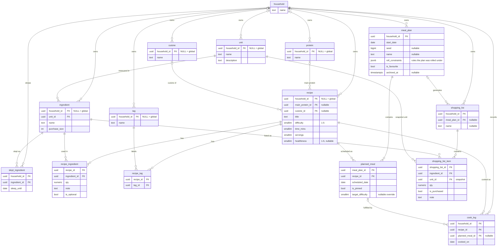

# Meal Roulette — MVP Data Model

> The database design for the MVP core loop: roll a week of dinners, generate a shopping
> list, and keep a history of what was cooked. Companion to [the roadmap](../product/roadmap.md)
> (features) and [the stack notes](stack.md) (tech). Migrations under
> `api/migrations` are the schema source of truth; this document is the map and the
> reasoning behind it.

## Scope

The MVP covers **dinners only**, for a **single household** running solo, with the
ownership and extensibility hooks needed so the roadmap's later tracks (auth, members,
pantry, ratings, pricing) slot in without painful retrofits. Everything past that line —
pantry state, ratings, cost/pricing, receipt OCR, per-member collaboration — is deferred
and not modelled here.

---

## The map

Every table also carries `id` (UUIDv7 primary key), `created_at`, and `updated_at`
(auto-maintained) — omitted from the diagram below to keep it legible.



---

## Conventions

These rules apply to every table and migration in the project.

### Tables & columns

- **Table names**: `snake_case`, **singular**, named for the entity (`recipe`, not
  `recipes` or `recipe_entity`). A row *is* one recipe.
- **Junction tables**: `parent_child`, both singular (`recipe_ingredient`, `recipe_tag`).
- **Primary key**: `id`, UUIDv7 (`DEFAULT uuidv7()`; requires Postgres 18).
- **Foreign keys**: `<referenced_table>_id` (`unit_id`, `recipe_id`, `main_protein_id`).
- **Timestamps**: every table has `created_at` and `updated_at` (`TIMESTAMPTZ`, default
  `now()`), with a `<table>_set_updated_at` trigger calling the shared `set_updated_at()`
  function. **No exceptions** — including junction, log, and lookup tables.
- **Booleans**: read as a predicate — prefix `is_` / `has_` (`is_optional`, `is_purchased`).
- **Controlled vocabularies** (unit, protein, cuisine, tag): modelled as **lookup tables**,
  not native Postgres `ENUM` types. Enums are painful to `ALTER`; lookup tables are
  extensible per-household and support the "presets + user-added" model the roadmap wants.

### Migrations

- Free-form description after the `sqlx` timestamp uses a **Rails-style verb-first** name:
  `create_<table>`, `add_<column>_to_<table>`, `remove_<column>_from_<table>`,
  `rename_<old>_to_<new>`, `drop_<table>`. The verb leads so `ls migrations/` reads as a
  changelog. Examples: `create_meal_plan`, `add_main_protein_to_recipe`,
  `remove_last_cooked_from_recipe`.
- Migrations are reversible (`-r`) and never edited once applied — a new migration supersedes.

### Constraint & index names

Named explicitly (never left to Postgres auto-naming) so error messages are legible and
`ALTER`/`DROP` targets are predictable:

| Object | Prefix | Example |
| --- | --- | --- |
| Primary key | `pk_` | `pk_recipe` |
| Foreign key | `fk_` | `fk_recipe_household` |
| Unique | `uq_` | `uq_recipe_household_title` |
| Check | `chk_` | `chk_recipe_difficulty_range` |
| Index | `idx_` | `idx_planned_meal_scheduled_date` |

### Reserved words (forward note)

`user` is a reserved keyword in Postgres and would need quoting everywhere. When auth
lands, the users table is named `app_user` (final choice deferred to the auth milestone).

---

## Ownership model

Ownership is **per household**, not per user — a household owns recipes and plans; individual
members and auth arrive later without touching these tables.

- A single `household` table anchors ownership. Solo use runs against one seeded row.
- **Catalog tables** (`recipe`, `ingredient`, `unit`, `protein`, `cuisine`, `tag`) carry a
  **nullable** `household_id`:
  - `household_id = <a household>` → owned by that household.
  - `household_id IS NULL` → a **global preset**, visible to everyone.
- **Household-specific tables** (`meal_plan`, `shopping_list`, `cook_log`,
  `slept_ingredient`) carry a **`NOT NULL`** `household_id` — there is no such thing as a
  global meal plan. Line tables (`planned_meal`, `shopping_list_item`, `recipe_ingredient`,
  `recipe_tag`) inherit scope through their parent and carry no `household_id` of their own.

### Uniqueness with nullable ownership

Uniqueness on catalog tables is scoped by household — e.g. one recipe title per household:

```sql
CONSTRAINT uq_recipe_household_title UNIQUE NULLS NOT DISTINCT (household_id, title)
```

`NULLS NOT DISTINCT` (Postgres 15+) makes two `NULL` household ids count as *equal* for the
constraint, so it also blocks duplicate **global** presets. Without it, Postgres treats each
`NULL` as distinct and would allow many global recipes with the same title.

Units start household-scoped (each household configures their own) and are expected to
migrate to global (`household_id = NULL`) once a shared, curated set stabilises.

---

## Entity reference

### Catalog

**`household`** — ownership anchor. `name`. Seed one row for solo use.

**`unit`** — units of measure (grams, ml, each…). `name`, `description`. Scoped by
`household_id` (nullable). `uq_unit_household_name`.

**`protein`**, **`cuisine`**, **`tag`** — lookup vocabularies for recipe attributes. Each:
`name`, nullable `household_id`, `uq_<table>_household_name`. `protein` and `cuisine` are
single-valued on a recipe (FK on `recipe`); `tag` is many-valued (via `recipe_tag`).

**`ingredient`** — a purchasable ingredient. `name`, `purchase_size`
(`chk_ingredient_purchase_size_positive CHECK (purchase_size > 0)`), `unit_id` (how it is
measured). Scoped by `household_id` (nullable). `uq_ingredient_household_name`.

### Recipe composition

**`recipe`** — recipe header and roll attributes.

| Column | Notes |
| --- | --- |
| `title` | `uq_recipe_household_title` with `household_id` |
| `difficulty` | `smallint`, `chk_recipe_difficulty_range CHECK (difficulty BETWEEN 1 AND 5)` |
| `time_mins` | `smallint`, `chk_recipe_time_mins_positive CHECK (time_mins > 0)` |
| `servings` | `smallint`, `> 0` — feeds leftovers planning later |
| `healthiness` | `smallint`, nullable, `BETWEEN 1 AND 5` |
| `main_protein_id` | FK → `protein`, nullable |
| `cuisine_id` | FK → `cuisine`, nullable |

The old `last_cooked` column is **removed** — recency now derives from `cook_log`
(`MAX(cooked_on)`), so there is a single source of truth.

**`recipe_ingredient`** — ingredients in a recipe. `recipe_id` (FK, `ON DELETE CASCADE`),
`ingredient_id` (FK, `ON DELETE RESTRICT` — an ingredient in use can't be deleted out from
under a recipe), `qty` (`numeric(10,2)`, `chk_recipe_ingredient_qty_positive CHECK
(qty > 0)`), `note`, `is_optional`. `uq_recipe_ingredient (recipe_id, ingredient_id)`. The
unit is implicit — the ingredient's own unit (matches the roadmap's "simple mode", where
recipe amounts and the ingredient are entered in the same unit, so no conversion is needed).

**`recipe_tag`** — recipe↔tag junction. `recipe_id` (`ON DELETE CASCADE`), `tag_id`
(`ON DELETE RESTRICT`). `uq_recipe_tag (recipe_id, tag_id)`.

### Planning & history

**`meal_plan`** — one rolled week (the header). `household_id` (`NOT NULL`), `start_date`,
`seed` (nullable — stored so a roll is reproducible, per the roadmap's seeded-rolls feature),
`name` (nullable label), `roll_constraints` (`JSONB`, default `{}`: the rules the plan was
rolled under, in the shape of `domain::roll::RollConstraints`, i.e. cuisine, protein,
must-use-ingredient and difficulty-band counts, each at least or at most, each Required or a
High / Medium / Low preference; kept so a single day can be re-rolled against the same rules.
Fields added later default when an older plan is read), `is_favourite` (default `false`),
`archived_at` (nullable; `NULL` = active). An archived plan keeps its days but drops out of the
active history and is never the "latest" plan the home and plan pages show. Deleting a plan
cascades to its days and frees their recipes to be deleted; its shopping list and cook-log
entries stay, unlinked (`SET NULL`).

**`planned_meal`** — one dinner slot in a plan. `meal_plan_id` (`ON DELETE CASCADE`),
`recipe_id` (`ON DELETE RESTRICT`), `scheduled_date`, `is_pinned` (the pin/keep feature),
`target_difficulty` (nullable — the per-day difficulty override; `NULL` means use the day's
default). `uq_planned_meal (meal_plan_id, scheduled_date)` — one dinner per day per plan;
`uq_planned_meal_recipe (meal_plan_id, recipe_id)` — a recipe appears at most once per plan,
whether the solver picked it or a swap chose it.

**`cook_log`** — the permanent record of what was actually cooked. `household_id`
(`NOT NULL`), `recipe_id` (`ON DELETE RESTRICT`), `cooked_on`, `planned_meal_id` (nullable
FK, `ON DELETE SET NULL` — links back to the plan slot when the cook came from a roll; null
for unplanned cooks, and history survives even if the plan is deleted). This table is the
source of truth for recency and min/max-interval rules, and the raw material for the
insights dashboard (most/least cooked).

### Shopping

**`shopping_list`** — a generated list (the header). `household_id` (`NOT NULL`),
`meal_plan_id` (nullable FK, `ON DELETE SET NULL` — the plan it was generated from; nullable
so a list can be ad-hoc or outlive its plan), `name` (nullable).
`uq_shopping_list_meal_plan (meal_plan_id)`: a plan has at most one list, which regenerating
updates in place. Ad-hoc lists (`meal_plan_id` `NULL`) never collide.

**`shopping_list_item`** — one aggregated line. `shopping_list_id` (`ON DELETE CASCADE`),
`ingredient_id` (`ON DELETE RESTRICT`), `qty` (`> 0`), `unit_id` (a **snapshot** of the
unit at generation time, so a historical list stays correct even if the ingredient's unit
is later changed), `is_purchased` (simple check-off; a purchased-at timestamp is a trivial
later add), `note`. `uq_shopping_list_item (shopping_list_id, ingredient_id)` — the list is
the summed union of the week's ingredients, one row per ingredient.

**`slept_ingredient`** — the MVP "sleep ingredients" feature. Sleeping is a persistent,
per-household relationship to an ingredient that spans weeks, so it is its own table, not a
flag on a single list. `household_id` (`NOT NULL`), `ingredient_id` (`ON DELETE CASCADE`),
`sleep_until` (the wake date). `uq_slept_ingredient (household_id, ingredient_id)`. When a
list is generated, ingredients with an active sleep are still shown but flagged "not adding".

---

## Key design decisions

- **`cook_log` is separate from `planned_meal`.** A plan is *intent*; a cook is *fact*. The
  split keeps the metrics log clean, lets unplanned cooking be recorded, and makes `cook_log`
  the single source of truth for recency/interval logic.
- **`recipe.last_cooked` removed**, derived from `cook_log` instead.
- **Nullable `household_id` on catalog tables** encodes global presets (`NULL`) vs owned
  rows, with `NULLS NOT DISTINCT` uniqueness so globals can't duplicate.
- **Snapshot `unit_id` on `shopping_list_item`** treats a past list as an immutable record.
- **Explicit constraint names + verb-first migrations** for a self-documenting schema.

---

## Deferred & extensibility hooks

Not built now, but the schema is shaped so these don't require rework:

- **Customizable recipe attributes.** MVP attributes (protein, cuisine, healthiness, tags)
  stay as **fixed columns**. A future "define your own attribute" feature takes one of two
  shapes, to be decided when it's reached:
  - **JSONB column** (`attributes jsonb` on `recipe` / `recipe_ingredient`) — flexible, no
    migration per attribute, but weaker typing and clunkier querying.
  - **EAV** (Entity-Attribute-Value): an `attribute_definition` table (name, data type,
    allowed values) plus `recipe_attribute` / `recipe_ingredient_attribute` join tables
    holding each value. More relational and queryable; more joins, and type-safety is
    hand-rolled. This generalises the lookup-table pattern already used for protein/cuisine.
- **Meal slots beyond dinner.** `planned_meal`'s uniqueness becomes
  `(meal_plan_id, scheduled_date, meal_slot)` when breakfast/lunch are added.
- **Ad-hoc shopping items.** Non-recipe items (foil, bin bags) need `ingredient_id` to
  become nullable on `shopping_list_item` plus a free-text name.
- **Members & auth.** An `app_user` table + household membership; core tables already carry
  `household_id`, so no backfill is required.
- **Purchase timing, ratings, pantry, cost.** New nullable columns or adjacent tables layered
  on `cook_log`, `shopping_list_item`, and `ingredient` — see [the roadmap](../product/roadmap.md).
